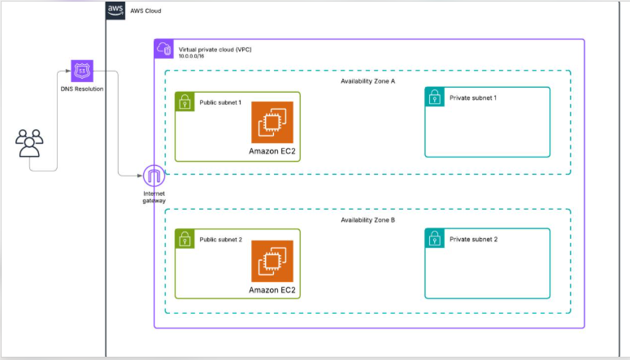
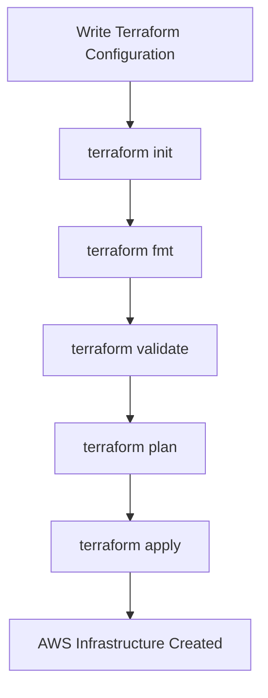
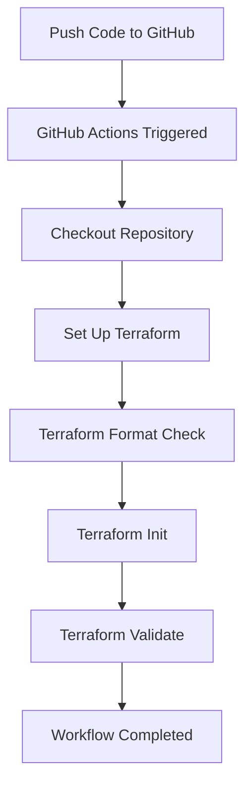
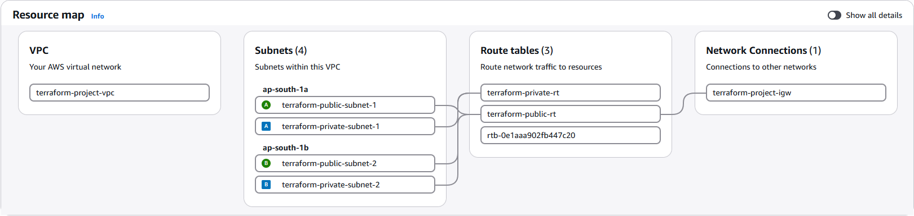
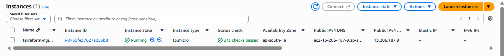
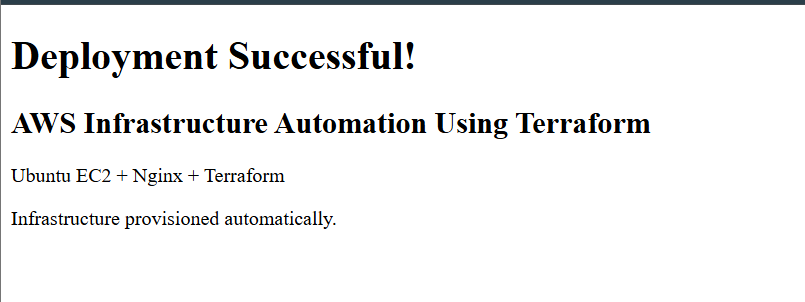
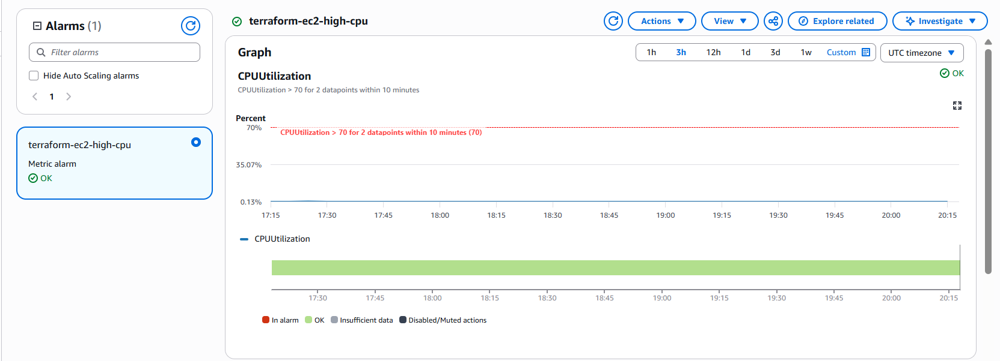
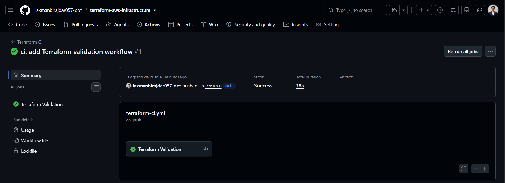
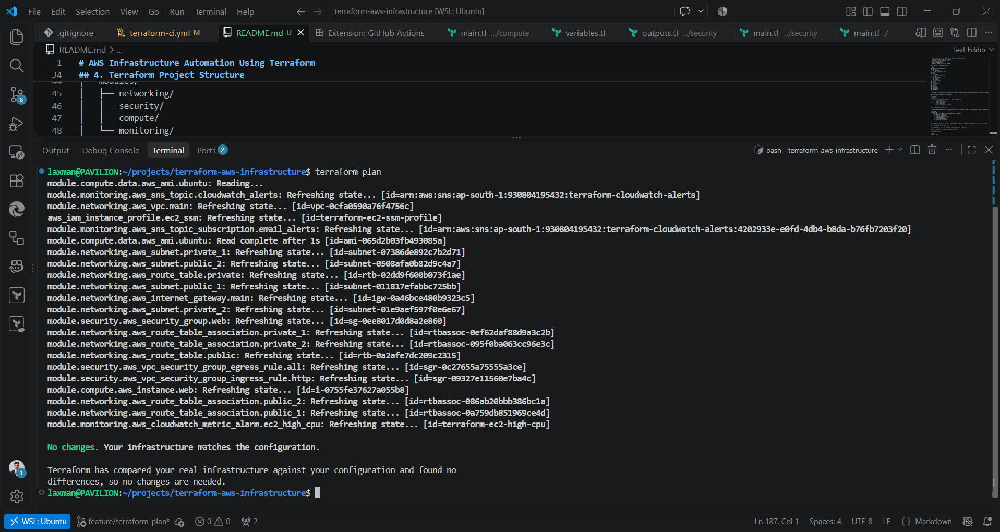

# AWS Infrastructure Automation Using Terraform

## 1. Project Overview

This project demonstrates how I used Terraform to provision and manage AWS infrastructure using Infrastructure as Code (IaC).

I created a custom VPC, public and private subnets, an Ubuntu EC2 instance running Nginx, IAM permissions for Systems Manager, and CloudWatch monitoring with email notifications.

I also configured GitHub Actions to automatically check Terraform formatting and validate the configuration whenever code is pushed to GitHub.

## 2. AWS Infrastructure Architecture



The infrastructure includes:
- One VPC (`10.0.0.0/16`) across two Availability Zones.
- Two public and two private subnets.
- An Internet Gateway and a public route table.
- An Ubuntu EC2 instance running Nginx in a public subnet.
- An IAM role for AWS Systems Manager access.
- CloudWatch CPU monitoring and SNS email notifications.

The private subnets are reserved for future use. No NAT Gateway or private EC2 instance is deployed.

## 3. Technologies Used

- **Cloud:** AWS (VPC, EC2, IAM, Systems Manager, CloudWatch, SNS)
- **Infrastructure as Code:** Terraform
- **Operating System:** Ubuntu Linux
- **Web Server:** Nginx
- **CI:** GitHub Actions
- **Version Control:** Git and GitHub

## 4. Terraform Project Structure

```text
terraform-aws-infrastructure/
├── .github/
│   └── workflows/
│       └── terraform-ci.yml
├── docs/
│   └── images/
│       └── architecture.png
├── modules/
│   ├── networking/
│   ├── security/
│   ├── compute/
│   └── monitoring/
├── main.tf
├── providers.tf
├── variables.tf
├── outputs.tf
├── iam.tf
├── moved.tf
├── userdata.sh
├── .gitignore
└── README.md
```

I separated the infrastructure into Terraform modules to keep the configuration organized and easier to maintain.

## 5. How Terraform Works in This Project



## 6. GitHub Actions CI Workflow

I configured GitHub Actions to automatically validate my Terraform code on pushes and pull requests to the main branch.



The CI pipeline checks the Terraform configuration. It does not automatically create or destroy AWS resources.

## 7. Deployment Instructions

**Prerequisites:** Terraform, AWS CLI, and configured AWS credentials.

Clone the repository and open the project directory.

Initialize Terraform:

```bash
terraform init
```

Check formatting and validate:

```bash
terraform fmt -check -recursive
terraform validate
```

Review the infrastructure changes:

```bash
terraform plan
```

Deploy the infrastructure:

```bash
terraform apply
```

View the deployed resource information:

```bash
terraform output
```

The SNS notification email must be configured through the Terraform input variable and its subscription confirmed.

To remove the infrastructure when it is no longer needed:

```bash
terraform destroy
```

## 8. Project Execution Screenshots

The following screenshots will be added as evidence of the actual deployment.

### VPC and Subnets



### Running EC2 Instance



### Nginx Web Server



### CloudWatch CPU Alarm



### Successful GitHub Actions Workflow



### Terraform Execution



## 9. Security Practices

- Restricted EC2 inbound access using security groups.
- Used an IAM role and AWS Systems Manager instead of opening SSH access.
- Enabled EBS volume encryption.
- Required IMDSv2 on the EC2 instance.
- Excluded Terraform state files, credentials, and variable files containing sensitive information from Git.
- Kept Terraform deployment manual rather than granting AWS deployment permissions to the CI workflow.

## 10. Key Learnings and Future Improvements

Through this project, I gained practical experience with Terraform modules, AWS networking, EC2 provisioning, IAM, monitoring, Git, and CI workflows.

Possible future improvements include:
- Configuring a secure remote Terraform backend.
- Adding automated infrastructure deployment with appropriate approval controls.
- Introducing a NAT Gateway if private subnet workloads require outbound internet access.
- Adding an Application Load Balancer and Auto Scaling.

---

**Project Type:** DevOps / Cloud / Infrastructure as Code  
**Purpose:** Hands-on learning and portfolio demonstration
